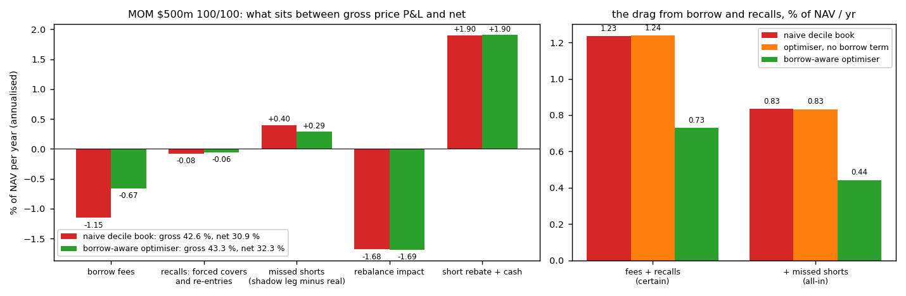
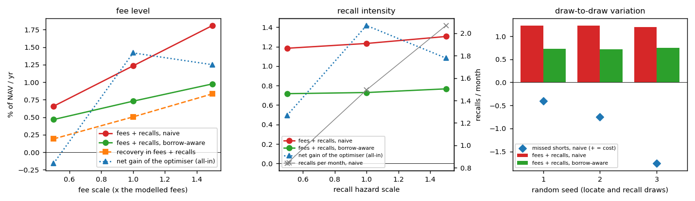

# securities-lending-analytics

Securities lending and financing analytics for a systematic long-short equity book: a borrow-cost database built from the free public record (FINRA short interest, Regulation SHO threshold lists, SEC fails to deliver), a locate and recall simulation, a borrow-aware optimiser and a prime-broker financing reconciliation. The book is $500m NAV, 100 % long and 100 % short, equal-weighted deciles of an 801-name US universe, rebalanced monthly from 2019-06-28 to 2026-08-31.

The question: how much of a long-short strategy's return goes to borrow fees and recalls, how often does a short become unavailable, and how much does a borrow-aware optimiser recover?

## Results

- **The bill.** On the 12-1 momentum book, fees and recalls cost 1.23 % of NAV a year: 1.15 % in fees (a weighted 1.37 % on the short leg) and 0.08 % in forced covers and re-entries. 3.6 % of the shorts requested at a rebalance could not be located, and 1.5 positions a month were recalled.
- **The recovery.** The borrow-aware optimiser brings that to 0.73 %, a recovery of 0.51 % of NAV a year. The fee saving is stable across assumptions. The all-in gain, once the alpha given up and the squeeze term are counted, is +1.42 % here but swings between -0.16 % and +2.14 % across the sensitivity grid.
- **Heavily shorted signals cost more.** Shorting the most-shorted decile costs 3.52 % a year, falling to 2.02 % with the optimiser.
- **The shorts a desk cannot borrow went up.** Over this sample the unlocatable names rose, so the momentum book was helped by 0.40 % a year by not holding them. That is the squeeze mechanism in Engelberg, Reed and Ringgenberg (2018), and it is why the all-in gain is unstable.
- **The reconciliation.** Nine kinds of seeded prime-broker discrepancy across 163,563 accrual lines: 99.6 % found and classified as the right type, 0 false positives.

| | 12-1 momentum | short-interest | 1-month reversal |
|---|---|---|---|
| fees + recalls, % of NAV a year, naive → borrow-aware | 1.23 → 0.73 | 3.52 → 2.02 | 0.57 → 0.46 |
| shorts not located, naive → borrow-aware | 3.6 % → 2.5 % | 5.7 % → 2.7 % | 4.8 % → 4.2 % |




All numbers are in `results/summary.md`; the detail is in [docs/method.md](docs/method.md).

## How it works

- **Data.** FINRA short interest (121,021 rows), Nasdaq and NYSE threshold lists, SEC fails to deliver, Yahoo prices and the NY Fed EFFR. A point-in-time ticker map comes from the CUSIPs in the fails data. Publication lags are respected.
- **Borrow model.** A daily specialness score from short interest, days to cover, threshold status, fails, volume and price. It maps to a fee through a published fee cross-section calibrated to D'Avolio (2002), with a utilisation floor, and gives a locate probability and a recall hazard.
- **Simulation.** Daily book with locates, recalls and re-entries, fees, rebate, cash interest, impact and margin, and a shadow short leg that holds every intended short.
- **Optimiser.** SLSQP with a tracking-variance penalty against the naive book and an expected borrow cost per short, so freed weight goes to cheaper near-substitutes.
- **Financing.** ACT/360 accruals, Regulation T and portfolio margin, and a prime-broker statement with seeded breaks to reconcile against.

## Limitations

- The universe is chosen on the latest short-interest file, so it is heavily shorted by construction and survivorship-biased. Absolute returns are context only.
- No borrow fee data was available: the Interactive Brokers file is not reachable from here, so fees come from a published cross-section and my assumptions.
- The modelled fee ordering has the opposite sign to the literature's on forward returns and is not significant.
- The squeeze term and the optimiser's all-in gain are not stable across draws.

## Run

```
scripts/run_all.sh --skip-download    # the whole pipeline on the committed data
python -m pytest -q                   # 35 tests
python -m slb run --quick --reuse     # the short variant CI runs
```

CI runs the tests, rebuilds the store and the borrow table, and runs a short pipeline.
